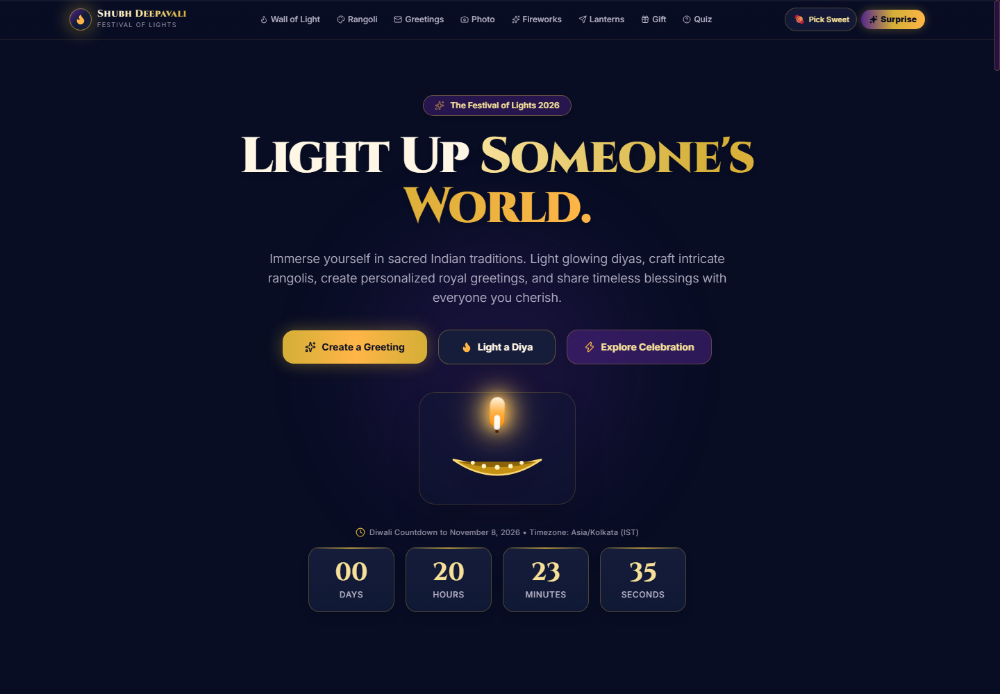
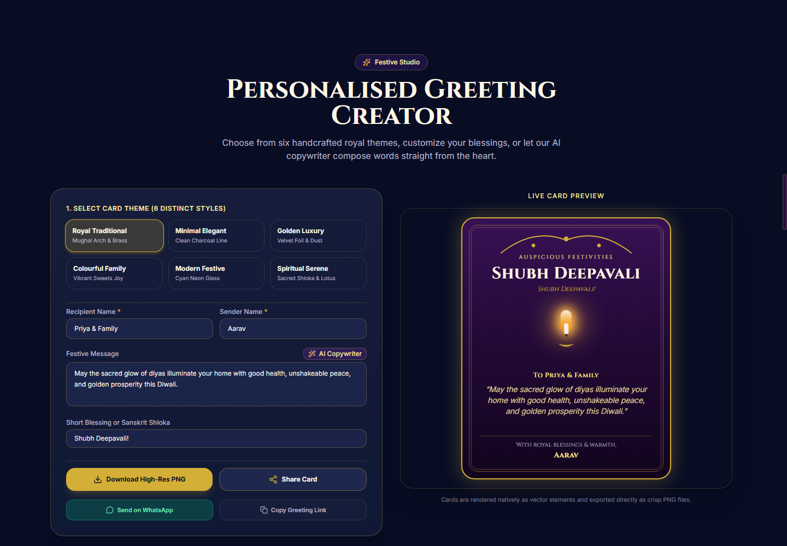

# 🪔 Diwali with Me! — Shubh Deepavali Festive Sanctuary

<div align="center">

**✨ An immersive, browser-first Diwali celebration — light diyas, draw rangolist, release sky lanterns, build royal mithai boxes, craft personalized greetings, and share the Festival of Lights with everyone you love. ✨**

[](https://nextjs.org/)
[](https://react.dev/)
[](https://www.typescriptlang.org/)
[](https://tailwindcss.com/)
[](https://firebase.google.com/)
[](LICENSE)

</div>

---

## 🎆 Screenshots

| 🏠 Home — Festival of Lights | 💌 Greeting Card Studio |
|:---:|:---:|
|  |  |

> 📸 **More feature screenshots** are referenced inline throughout this README in each feature section below.

---

## 🌟 Feature Overview

Shubh Deepavali brings authentic Indian festive traditions to life in a beautiful, interactive web experience. Everything works without an account or database — most features are purely client-side. Cloud sync via Firebase is available as an optional enhancement so visitors across the world can see each other's diyas and lanterns in real time.

---

## 🕯️ Core Features

### 1. 🪔 Wall of Light — Light a Diya for Someone

Light a glowing digital diya and dedicate it to someone you love. Choose from multiple beautifully crafted diya styles, each illuminated with a warm golden flame and glow aura.

- **9 Diya Styles** including Brass Pital, Terracotta, Silver Chandi, Crystal, Copper, Clay, Marble, Lotus, and Festival styles
- **Dedication & name** — add a personal message and recipient's name
- **Privacy opt-in** — choose whether to display your diya on the global Wall of Light
- **Firebase real-time sync** — public diyas appear live on all visitors' screens worldwide 🌍
- **View All overlay** — browse all lit diyas with search and style filters without cluttering the main page
- **Share link** — after lighting, share your individual diya page with a friend

**How it works:** Each diya's data (style, message, name, public flag) is stored in Firebase Firestore with real-time listeners. The main page shows a live preview of the latest 6 diyas; a **"View All Diyas"** button opens a modal with full search and filter capabilities.

---

### 2. 🏮 Release a Sky Lantern — Make a Wish for the World

Write a heartfelt wish or prayer for the world, choose your lantern's colour glow, and watch it ascend into the celestial night sky with a shimmer sound and floating animation.

- **4 Lantern Colours** — Golden Amber 🟡, Saffron Peace 🟠, Rose Harmony 🌸, Emerald Hope 💚
- **Live wish inscription** — your wish text appears on the lantern body before you release it
- **Privacy opt-in** — choose whether your wish appears on the global Wish Constellation wall
- **Firebase real-time sync** — public wishes from visitors worldwide appear live on the Wish Wall 🌍
- **Wish Wall** — a constellation of lanterns from people everywhere with search and colour filters
- **View All overlay** — full modal with filtering, timestamps, and search
- **📤 Direct lantern share link** — after releasing, three share options appear:
  - **WhatsApp** — sends your wish text + a unique link to your specific lantern
  - **Copy Lantern Link** — copies `/share?lantern=<encoded>` with your name, wish, and colour
  - **More** — native system share sheet (great on mobile)
- **Recipient experience** — opening your share link shows an animated floating lantern in your colour, your wish inscribed on it, a "Send Blessing" button with confetti, and a CTA to release their own lantern

**How it works:** Lantern data is URL-safe base64 encoded in the share link — no server or database needed to view a shared lantern. Firebase is only used for the public Wish Wall.

---

### 3. 🎨 Rangoli Studio — Draw Rangoli with Sacred Symmetry

Create intricate, symmetrical digital rangoli patterns in a fully interactive drawing canvas.

- **Radial 8-fold symmetry** — every stroke is mirrored across all axes simultaneously
- **Preset patterns** — choose from curated traditional rangoli designs as a starting base
- **Custom colour palette** — full Diwali colour set including saffron, vermilion, marigold, emerald, and ivory
- **Brush size control** — from fine detail work to bold fills
- **Export** — download your rangoli as a high-resolution PNG image
- **Clear canvas** — start over any time

---

### 4. 💌 Greeting Card Creator — Six Royal Card Themes

Craft a personalised Diwali greeting card in six distinct handcrafted themes, preview it live, and share it with anyone anywhere.

- **6 card themes:**
  - 👑 **Royal Traditional** — deep crimson and gold palace motifs
  - 🌸 **Minimal Elegant** — clean ivory with thin gold accents
  - ✨ **Golden Luxury** — full gold with foil-texture overlays
  - 🎉 **Colourful Family** — vibrant, joyful multi-colour palette
  - 💜 **Modern Festive** — contemporary purple and midnight design
  - 🕉️ **Spiritual Serene** — calm deep blue with sacred geometry
- **Customisation fields** — Recipient name, Sender name, Personal message, Festive blessing
- **AI copywriting** — optional Gemini-powered greeting generator for tailored messages; a curated local fallback always works without an API key
- **Share via URL** — card data is encoded in the share link; no database needed
- **WhatsApp share** — one click opens WhatsApp with your card link
- **Download PNG** — exports a high-resolution card image via `html-to-image`

---

### 5. 📸 Photo Greeting Studio — Personalised Photo Cards

Add your own photo to create a fully personalised festive greeting.

- **Photo upload & live preview** — drag and drop or select an image
- **Festive frame overlays** — apply beautiful Diwali-themed frames and ornaments around your photo
- **Zoom & position control** — adjust cropping and framing with precision
- **In-browser processing** — photos never leave your device; all rendering happens client-side
- **Export PNG** — download your personalised photo greeting card

---

### 6. 🎁 Royal Mithai Box Studio — Curate & Share a Diwali Sweet Box

Build a luxury royal Diwali mithai gift box, fill it with authentic Indian sweets, personalise it, and send it to anyone with a beautiful interactive unboxing experience.

- **9 Authentic Sweet SVG Visuals** (all handcrafted):
  | Sweet | Detail |
  |---|---|
  | 💎 **Kaju Katli** | Diamond-cut cashew fudge with edible silver *vark* foil texture |
  | 🟡 **Motichoor Ladoo** | Fried boondi pearl sphere with pistachio slivers |
  | 🟤 **Gulab Jamun** | Fried chenna dumpling in amber sugar syrup glaze |
  | 🍰 **Soan Papdi** | Flaky layered cube with crushed pistachio & almond topping |
  | 🟢 **Kaju Pista Roll** | Emerald pistachio core rolled in cashew shell |
  | 🟠 **Besan Ladoo** | Roasted gram flour sphere with saffron strands |
  | 🌀 **Jalebi** | Spiral pretzel soaked in amber saffron syrup |
  | ⚪ **Rasgulla** | Snow-white spongy chenna dumpling in rose syrup |
  | 🌙 **Gujiya** | Crescent hand-folded pastry with fluted crimped edge |

- **6-slot Royal Gift Tray** — 2 rows × 3 columns with gold pleated cup liners; sweets drop in with satisfying animation
- **3 Luxury Box Themes:**
  - 🏮 **Royal Ruby Crimson** — deep red velvet with gold filigree inlays
  - 🌌 **Midnight Royal Gold** — deep navy silk with gold borders
  - ✨ **Marigold & Brass** — warm amber-saffron with brass metal accents
- **Chef's Assortment** — instant randomized curated sweet selection
- **Personalisation card** — recipient name, sender name, festive message with preset blessing chips
- **Share options:**
  - **WhatsApp** — opens with personalised text and gift link
  - **Copy Link** — `/share?box=<encoded>` for anyone to open
  - **Download PNG** — exports the full gift card as a high-res image
  - **Preview Unboxing** — see the recipient experience before you send

- **Recipient Unboxing Experience** — opening a gift link shows:
  - A sealed box with satin ribbons, brass corner brackets, and a golden wax seal (🪔 `SHUBH`)
  - Tap the seal to unbox with sound effect + confetti burst
  - Full sweet tray revealed with the personalised letter card
  - CTA to send a mithai box back and explore the festive sanctuary

---

### 7. 🎇 Interactive Celestial Fireworks

A zero-emission, zero-noise fireworks canvas you can interact with without leaving your screen.

- **Hover & click to launch** — move your cursor or tap to ignite golden spark bursts
- **Physics simulation** — realistic gravity, fade, and colour trails
- **Firework Facts sidebar** — learn fascinating facts about Indian fireworks culture
- **Eco-conscious** — zero emissions, completely safe for pets and wildlife 🌿

---

### 8. 🎁 Mystery Diwali Gift Box

A beautifully animated surprise gift box that reveals a random festive surprise when opened.

- Satisfying lid-open animation with confetti and chime sound
- Each reveal is different — a fun element of surprise
- Shareable moment to delight friends and family

---

### 9. 🧠 Festive Personality Quiz — What's Your Mithai?

A fun interactive quiz that reveals your Diwali mithai personality.

- Multiple-choice questions about your festival style and preferences
- Personality result with a matching mithai recommendation and description
- Shareable result card

---

### 10. 🎵 Ambient Festive Music & Sound Effects

A floating audio controller that provides an immersive soundscape for the entire experience.

- **3 ambient music tracks** — Diwali Celebration Beats (Bansuri Flute), Festive Sitar, Santoor Celebration
- **Autoplay on first gesture** — music starts gently on the first user interaction
- **Sound effects** — diya lighting chime, lantern shimmer, gift reveal fanfare, subtle navigation clicks
- **Mute/unmute toggle** — always accessible from the floating audio bar
- **Track selector** — switch between tracks while browsing

---

### 11. 🗓️ Diwali Countdown Timer

A live countdown to Diwali in India Standard Time.

- Day, hour, minute, second counters
- Transitions to a celebratory display once the festival date arrives
- Automatically adjusts for IST timezone

---

### 12. 🎬 Cinematic Welcome Experience

An immersive fullscreen opening ceremony on first visit.

- **Animated welcome screen** with floating diya particles and golden text
- **Sweet personality quiz** — choose Kaju Katli, Soan Papdi, or Both, displayed as a welcome badge throughout the visit
- **Skip option** for returning visitors — after the first visit, the site remembers your preference within the session

---

## 💛 Design Philosophy

| Principle | Implementation |
|---|---|
| ✅ **No account required** | The full experience loads instantly without login or signup |
| 🔒 **Privacy-conscious** | Photos stay in-browser; diya/lantern entries require explicit opt-in to appear publicly |
| 🌐 **Works offline-first** | Core features function without Firebase configured |
| 💸 **Zero API cost for core features** | Greeting codec, lantern sharing, and mithai box all use URL encoding — no server |
| 📱 **Mobile-first responsive** | All interactions are touch-friendly; layouts adapt from mobile to widescreen |
| ♿ **Accessible by design** | All form controls have `id`, `htmlFor`, and `aria-label` attributes |
| 🌍 **Real-time global sync** | Firebase Firestore connects visitors worldwide on the Wall of Light and Wish Wall |

---

## 🛠️ Technology Stack

| Area | Tools |
|---|---|
| **Framework & UI** | Next.js 16 App Router, React 19, TypeScript 5 |
| **Styling & Animation** | Tailwind CSS v3, CSS keyframes, Tailwind `animate-` utilities |
| **Icons** | Lucide React |
| **Drawing & Canvas** | HTML Canvas (Rangoli), `canvas-confetti` (celebrations) |
| **SVG Illustrations** | Hand-authored SVG with gradients for all 9 mithai sweets and diya styles |
| **Audio** | Web Audio API (procedural synth SFX) + HTML `<audio>` (ambient music) |
| **Card & Box Export** | `html-to-image` (client-side PNG download) |
| **Share Codec** | URL-safe Base64 (greetings, mithai boxes, sky lanterns — zero server cost) |
| **Cloud Sync** | Firebase Firestore (public Wall of Light & Wish Wall real-time sync) |
| **AI Copywriting** | Google Gemini API (server route) with curated local fallback |
| **Testing** | Node.js built-in `node:test` + TypeScript transpilation |

---

## 🚀 Run Locally

### 📋 Requirements

- **Node.js 20.9** or later
- **npm**

### ⚡ Install and Start

```bash
git clone https://github.com/sagnikdevelops/Diwali-with-me.git
cd Diwali-with-me
npm install
npm run dev
```

Open [http://localhost:3000](http://localhost:3000) — the site loads instantly, no credentials needed.

---

### 🤖 Optional: AI Greeting Generation

The site works fully without any API key. To enable live Gemini-powered festive greeting copywriting:

```powershell
# Windows PowerShell
Copy-Item .env.example .env.local
```

```dotenv
# .env.local
GEMINI_API_KEY=your_gemini_api_key_here
```

The curated greeting fallback remains available automatically when the key is absent.

---

### 🔥 Optional: Firebase Real-Time Sync

To enable cross-device, real-time sync for the Wall of Light and Wish Wall (so visitors worldwide can see each other's diyas and lanterns):

1. Create a Firebase project at [console.firebase.google.com](https://console.firebase.google.com)
2. Enable **Cloud Firestore** in your project
3. Add your Firebase config to `.env.local`:

```dotenv
NEXT_PUBLIC_FIREBASE_API_KEY=your_api_key
NEXT_PUBLIC_FIREBASE_AUTH_DOMAIN=your_project.firebaseapp.com
NEXT_PUBLIC_FIREBASE_PROJECT_ID=your_project_id
NEXT_PUBLIC_FIREBASE_STORAGE_BUCKET=your_project.appspot.com
NEXT_PUBLIC_FIREBASE_MESSAGING_SENDER_ID=your_sender_id
NEXT_PUBLIC_FIREBASE_APP_ID=your_app_id
```

4. Publish these Firestore security rules (Firestore → Rules):

```
rules_version = '2';
service cloud.firestore {
  match /databases/{database}/documents {
    match /diyas/{id} {
      allow read: if true;
      allow create: if request.resource.data.isPublic == true;
    }
    match /lanterns/{id} {
      allow read: if true;
      allow create: if request.resource.data.isPublic == true;
    }
  }
}
```

Without Firebase configured, the experience works in local-only mode — entries are saved to `localStorage` and visible on that device only.

---

## 🧪 Quality Checks

```bash
npm run lint    # ESLint — 0 errors
npm test        # 10 regression tests covering all major features
npm run build   # Next.js Turbopack production build
```

### 🔬 Test Coverage (10 tests)

| Test ID | What it verifies |
|---|---|
| **QA-01** | Wall of Light & Wish Wall only show explicitly public entries |
| **QA-03** | Greeting share codec round-trips Unicode payloads and rejects malformed data |
| **QA-04** | Clipboard utility uses Clipboard API with legacy `execCommand` fallback |
| **QA-05** | All form controls have `id`, `htmlFor`, and `aria-label` attributes |
| **QA-07** | Walls cap preview on main page (6 diyas / 4 lanterns) with View All overlay modals |
| **QA-08** | Mithai box codec round-trips payloads, bounds sweets, renders all 9 sweet SVGs |
| **QA-09** | Sky Lantern share encodes user's specific lantern; share page decodes `?lantern=` |
| *(audio)* | All ambient tracks and SFX files exist and are non-empty |
| *(fireworks)* | Fireworks are hover-interactive; audio autoplays with gesture fallback |
| *(API)* | Greeting request validator rejects invalid fields and bounds lengths |

---

## 📁 Project Structure

```text
src/
  app/
    page.tsx              Main festive experience page
    share/page.tsx        Share viewer for greetings, lanterns & mithai boxes
    api/generate-greeting Gemini AI greeting generation endpoint
  components/
    audio/                AudioBar — ambient music player & sound effects
    countdown/            Diwali countdown timer
    diya/                 Wall of Light, diya styles, lighting modal, View All modal
    fireworks/            Interactive canvas fireworks
    footer/               Festive footer with copyright
    greeting/             Greeting creator, photo greeting, AI modal, 6 card templates
    header/               Sticky festive header with scroll progress bar
    intro/                Cinematic welcome screen & sweet choice modal
    lanterns/             Sky Lanterns, Wish Wall, View All modal
    mithai/               Mithai Box Studio, Unbox Modal, 9 Sweet SVG visuals, types
    rangoli/              Rangoli Studio with symmetry canvas
    surprise/             Mystery gift box & festive quiz
  config/                 Festival date settings and curated greeting content
  lib/
    audio-synth.ts        Procedural Web Audio API sound effects
    firebase.ts           Firestore integration (optional)
    share-codec.ts        URL-safe base64 codec for greetings, boxes & lanterns
    utils.ts              Clipboard and general utilities
public/
  audio/                  3 ambient music tracks + sound effects
  screenshots/            README and documentation screenshots
tests/
  qa-regression.test.mjs  10 automated regression tests
```

---

## 🌐 Share Link Architecture

All sharing is **zero-cost** — no server or database needed to view a shared link. Data is encoded directly into the URL using URL-safe Base64.

| Share Type | URL Parameter | Contents |
|---|---|---|
| 🎴 Greeting Card | `/share?data=<token>` | Template, recipient, sender, message, blessing |
| 🏮 Sky Lantern | `/share?lantern=<token>` | Name, wish, lantern colour, timestamp |
| 🎁 Mithai Box | `/share?box=<token>` | Recipient, sender, message, box theme, up to 6 sweets |

The `/share` page auto-detects which parameter is present and renders the appropriate ceremony — greeting card view, celestial lantern float, or royal gift box unboxing.

---

## ☁️ Deployment

Deploy to any Next.js-compatible host (Vercel recommended):

```bash
npm run build   # Verify build succeeds locally first
```

**Vercel environment variables to set:**

| Variable | Required for |
|---|---|
| `GEMINI_API_KEY` | AI-powered greeting generation |
| `NEXT_PUBLIC_FIREBASE_*` | Real-time global Wall of Light & Wish Wall sync |

The site is **fully functional** without either — both are opt-in enhancements.

---

## 📚 Additional Documentation

| Document | Contents |
|---|---|
| [PROJECT_DOCUMENTATION.md](PROJECT_DOCUMENTATION.md) | Detailed feature behaviour and usage flows |
| [WEBSITE_ARCHITECTURE.md](WEBSITE_ARCHITECTURE.md) | Routes, components, and data flow diagrams |
| [DESIGN_SYSTEM.md](DESIGN_SYSTEM.md) | Visual tokens, colour palette, and design guidance |
| [QA_REPORT.md](QA_REPORT.md) | Test cases, testing strategy, and quality notes |

---

## 🗓️ What's New (Changelog Highlights)

| Version / Feature | Description |
|---|---|
| 🎁 **Royal Mithai Box Studio** | Build, personalise, and share a royal Diwali sweet gift box with authentic SVG sweets and an interactive unboxing experience for the recipient |
| 🏮 **Sky Lantern Direct Share** | Share your specific released lantern (wish, name, colour) via a unique `/share?lantern=` link instead of just the homepage |
| 🌍 **Firebase Global Sync** | Wall of Light and Wish Wall entries sync across all visitors worldwide in real time via Cloud Firestore |
| 🔭 **View All Overlays** | Browse all community diyas and lanterns in searchable, filterable overlay modals without cluttering the main page |
| 🎵 **Ambient Music System** | Auto-playing festive soundtrack with 3 tracks and procedural sound effects for every interaction |
| 🎇 **Hover Fireworks** | Interactive fireworks respond to cursor hover and tap — no auto-launch, fully on-demand |

---

## 👤 Author & License

<div align="center">

**Created with 🪔 and ❤️ by [Sagnik Dutta](https://www.linkedin.com/in/sagnikduttahere/)**

*Diwali with Me! — Shubh Deepavali Festive Sanctuary*  
*Kartik Amavasya / November 2026*

---

> **© 2026 Sagnik Dutta. All rights reserved.**
>
> This project — including all source code, design tokens, SVG assets, audio arrangements, and digital experiences — is the exclusive intellectual property of Sagnik Dutta.
>
> This project is provided under proprietary terms as a hackathon submission. Viewing the source code for educational reference is permitted. Copying, redistributing, re-submitting to competitions, or using any part of this project commercially or in derivative works without explicit written permission is strictly prohibited.
>
> See [LICENSE](LICENSE) and [NOTICE](NOTICE) for complete legal terms.

</div>
